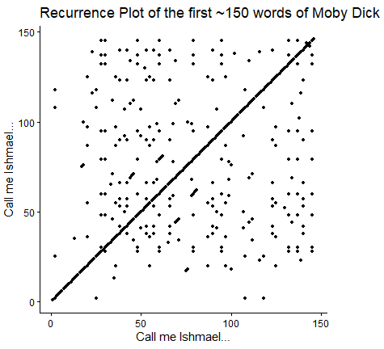
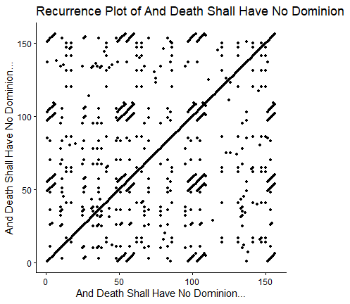
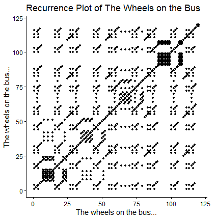

## Outline

1) Setup (R, RStudio, GitHub)
2) Conceptual Intro to Recurrence
3) Tutorial w/ example data

# Setup

## Downloading R & RStudio

## Pull tutorial from Github

1) Go to github.com/d-a-heath

2) Click on "colloquium-rqa-tutorial

3) Click on the green "Code" button

4) In the drop-down, click "Download ZIP" (it's at the bottom)

5) After downloading, extract the ZIP file

6) open the folder, then click on colloquium-rqa-tutorial.Rproj

7) Now, in RStudio, in the files pane (bottom right), click on "rqa-tutorial-worksheet"

# Conceptual Intro to Recurrence

## Recurrence: It's all coming back to me now

To recur is to pass through a similar state at a later point in time (e.g., I was hungry, then I ate. In a few hours, I will return to a state of being hungry). 

Recurrence is a ubiquitous feature in natural systems.

## Who cares?

- Ok, so what?

- Well, we all work with human data, and humans, being natural systems, also display recurrence at every level.
We're all very grateful for recurrence in the states of the muscles in our hearts, for example. 

- Human behavior also tends to recur, and through the arcane rites of Recurrence Quantification, we can learn about how behavior is organized. 

## What kind of behavior?

Any kind, as long as it is temporally organized!

t1, t2, t3, t4, etc... 

Patterns of recurrence are patterns in time, so we need data that has temporal structure. 

This could be...

- SRL codes
- Student generated texts
- Flash card success/fails
  
## Big picture

data -> RP -> metrics

maybe look at wallot and leonardi flow chart

# Tutorial
work along sheet title

## Setup

```{r, warning=FALSE}
#| echo: true
#| warning: false

library(tidyverse) 
library(crqa)
library(gt)

```

tidyverse is going to help us keep everything organized
crqa is how we'll run the recurrence analysis

## Data

```{r}
#| echo: true

texts <- read.csv("texts.csv")
```
Again, in principle, this could be any kind of data, but these make for a convenient example

## Parameters
Parameters determine how the data is transformed into an RP and how the RP is quantified. 

For categorical data, we can use standard values.

Just show picture example here

Embedding and delay are sort of like 3d glasses

## Metrics

# Example 1: Moby Dick {background-image="images/beale_frontspiece.jpg" background-opacity="0.5"}
*Boats Attacking Whales*, Thomas Beale 1839

## From data to plots {background-image="images/beale_frontspiece.jpg" background-opacity="0.2"}

:::: {.columns}

::: {.column}

From this...

::: {style="font-size: 0.5em; line-height:1;"}
Call me Ishmael. Some years ago- never mind how long precisely- having little or no money in my purse, and nothing particular to interest me on shore, I thought I would sail about a little and see the watery part of the world. It is a way I have of driving off the spleen and regulating the circulation. Whenever I find myself growing grim about the mouth; whenever it is a damp, drizzly November in my soul; whenever I find myself involuntarily pausing before coffin warehouses, and bringing up the rear of every funeral I meet; and especially whenever my hypos get such an upper hand of me, that it requires a strong moral principle to prevent me from deliberately stepping into the street, and methodically knocking people's hats off- then, I account it high time to get to sea as soon as I can.
:::

:::

:::{.column}

to this


::: 

::::

## RQA: Moby {background-image="images/beale_frontspiece.jpg" background-opacity="0.2"}

::::{.columns}

:::{.column}

- We are going to use the *crqa* function, and save it to an object called *moby_for_plot*.
- The data is specified inside the function.
- The parameters are set inside the function.
:::

:::{.column}
```{r}
#| echo: true

moby_for_plot <- crqa(ts1 = texts$moby,
                 ts2 = texts$moby,
                 delay = 1,
                 embed = 1,
                 rescale = 0,
                 radius = 0.001,
                 normalize = 0,
                 mindiagline = 2,
                 minvertline = 2,
                 tw = 0,
                 whiteline = FALSE,
                 recpt = FALSE,
                 side = "both",
                 method = "rqa",
                 metric = "euclidean",
                 datatype = "categorical")
```
:::

::::

## Recurrence Plot: Moby Dick {background-image="images/beale_frontspiece.jpg" background-opacity="0.2"}

::::{.columns}

:::{.column}
The RP is an element inside the moby_for_plot object, and we call it inside the plotting function using the **$** operator

```{r}
#| echo: true
#| output: false

plot_rp(moby_for_plot$RP,
                  title = "Recurrence Plot of the first ~150 words of Moby Dick",
                  xlabel = "Call me Ishmael...",
                  ylabel = "Call me Ishmael...",
                  pcolour = "black",
                  geom = c("void"),
                  flip_y = FALSE) +
                    geom_point(size = 1)

```
:::

::: {.column}

:::

::::

## From plots to metrics {background-image="images/beale_frontspiece.jpg" background-opacity="0.2"}

:::: {.columns}

::: {.column}
Ok, so now we want to go from our plot...

:::

::: {.column}
to metrics describing the plot

::: {style="font-size: 0.5em;"}
- Recurrence Rate (RR)
- Determinism (DET)
- Number of Lines (NRLINE)
- Average Line Length (L)
- Longest Line (MaxL)
- Entropy (ENTR)
- Laminarity (LAM)
- Trapping Time (TT)
:::

:::

::::

## Recurrence Metrics: Moby Dick {background-image="images/beale_frontspiece.jpg" background-opacity="0.2"}


First, we need to run our analysis again with one parameter changed (*tw = 1*), and save them to a new object (*moby_for_metric*)

```{r}
#| echo: true
#| warning: false

moby_for_metric <- crqa(ts1 = texts$moby,
                 ts2 = texts$moby,
                 delay = 1,
                 embed = 1,
                 rescale = 0,
                 radius = 0.001,
                 normalize = 0,
                 mindiagline = 2,
                 minvertline = 2,
                 tw = 1,
                 whiteline = FALSE,
                 recpt = FALSE,
                 side = "both",
                 method = "rqa",
                 metric = "euclidean",
                 datatype = "categorical")

```

## hypothetically {background-image="images/beale_frontspiece.jpg" background-opacity="0.2"}

if we plotted this updated version, it would look like this
```{r}
#| echo: false
#| output: true

plot_rp(moby_for_metric$RP,
                  title = "Recurrence Plot of the first ~150 words of Moby Dick",
                  xlabel = "Call me Ishmael...",
                  ylabel = "Call me Ishmael...",
                  pcolour = "black",
                  geom = c("void"),
                  flip_y = FALSE) +
                    geom_point(size = 1)

```


## Recurrence Metrics: Moby Dick {background-image="images/beale_frontspiece.jpg" background-opacity="0.2"}

Then we need to make a home for our metrics (*moby_output*) and then extract the metrics from our new object. 

```{r}
#|echo: TRUE
#|output: column
moby_output <- data.frame()

moby_output <- rbind(moby_output,
                       cbind("RR" = moby_for_metric$RR,
                             "DET" = moby_for_metric$DET,
                             "NRLINE" = moby_for_metric$NRLINE,
                             "MaxL" = moby_for_metric$maxL,
                             "L" = moby_for_metric$L,
                             "ENTR" = moby_for_metric$ENTR,
                             "LAM" = moby_for_metric$LAM,
                             "TT" = moby_for_metric$TT))

gt(moby_output)
```

## Let's try a couple more texts

## RQA: And death shall have no dominion {background-image="images/white_horse.jpg" background-opacity="0.2"}

::::{.columns}

:::{.column}
And Death Shall Have No Dominion
Dylan Thomas

:::{style="font-size: 0.5em;"}
And death shall have no dominion.
Dead men naked they shall be one
With the man in the wind and the west moon;
When their bones are picked clean and the clean bones gone,
They shall have stars at elbow and foot;
Though they go mad they shall be sane,
Though they sink through the sea they shall rise again;
Though lovers be lost love shall not;
And death shall have no dominion.
...
img: White Horse tavern, Wikipedia
:::

:::

:::{.column}
```{r}
#| echo: TRUE
#| warnings: True 

death_for_plot <- crqa(ts1 = texts$death,
                 ts2 = texts$death,
                 delay = 1,
                 embed = 1,
                 rescale = 0,
                 radius = 0.001,
                 normalize = 0,
                 mindiagline = 2,
                 minvertline = 2,
                 tw = 0,
                 whiteline = FALSE,
                 recpt = FALSE,
                 side = "both",
                 method = "rqa",
                 metric = "euclidean",
                 datatype = "categorical")
```
:::

::::

## Recurrence Plot: And Death Shall Have No Dominion {background-image="images/white_horse.jpg" background-opacity="0.2"}

::::{.columns}

:::{.column}
```{r}
#| echo: true
#| output: false

death_rp <- death_for_plot$RP

plot_rp(death_rp,
                  title = "Recurrence Plot of And Death Shall Have No Dominion",
                  xlabel = "And Death Shall Have No Dominion...",
                  ylabel = "And Death Shall Have No Dominion...",
                  pcolour = "black",
                  geom = c("void"),
                  flip_y = FALSE) +
                    geom_point(size = 1)

```
:::

:::{.column}

:::

::::
## Run RQAs: The Wheels on the Bus {background-image="images/bus.jpg" background-opacity="0.2"}

:::: {.columns}

::: {.column width="40%"}

### The Wheels on the Bus
*Verna Hills*

:::{style="font-size:0.7em;"}
The wheels on the bus go round and round

Round and round

Round and round

The wheels on the bus go round and round

All through the town
:::

:::

::: {.column width="60%"}

```{r}
#| echo: true

wheels_for_plot <- crqa(
    ts1 = texts$wheels,
    ts2 = texts$wheels,
    delay = 1,
    embed = 1,
    rescale = 0,
    radius = 0.001,
    normalize = 0,
    mindiagline = 2,
    minvertline = 2,
    tw = 0,
    whiteline = FALSE,
    recpt = FALSE,
    side = "both",
    method = "rqa",
    metric = "euclidean",
    datatype = "categorical"
)
```

:::

::::

## Recurrence Plot: The Wheels on the Bus {background-image="images/bus.jpg" background-opacity="0.2"}
::::{.columns}

:::{.column}
```{r}
#| echo: true
#| output: false

wheels_rp <- wheels_for_plot$RP

plot_rp(wheels_rp,
                  title = "Recurrence Plot of The Wheels on the Bus",
                  xlabel = "The wheels on the bus...",
                  ylabel = "The wheels on the bus...",
                  pcolour = "black",
                  geom = c("void"),
                  flip_y = FALSE) +
                    geom_point(size = 1)

```
:::

:::{.column}

:::

::::
## Let's look at all our plots

:::: {.columns}

::: {.column width="33%"}

:::

::: {.column width="35%"}

:::

::: {.column width="32%"}

:::

::::

## Get Metrics
Ok, so we've got some plots. But what we really want is numbers describing those plots.
So we need to run the crqa function for death and wheels again with tw = 1

```{r}
death_for_metric <- crqa(ts1 = texts$death,
                 ts2 = texts$death,
                 delay = 1,
                 embed = 1,
                 rescale = 0,
                 radius = 0.001,
                 normalize = 0,
                 mindiagline = 2,
                 minvertline = 2,
                 tw = 1,
                 whiteline = FALSE,
                 recpt = FALSE,
                 side = "both",
                 method = "rqa",
                 metric = "euclidean",
                 datatype = "categorical")
```


```{r}
wheels_for_metric <- crqa(ts1 = texts$wheels,
                 ts2 = texts$wheels,
                 delay = 1,
                 embed = 1,
                 rescale = 0,
                 radius = 0.001,
                 normalize = 0,
                 mindiagline = 2,
                 minvertline = 2,
                 tw = 1,
                 whiteline = FALSE,
                 recpt = FALSE,
                 side = "both",
                 method = "rqa",
                 metric = "euclidean",
                 datatype = "categorical")
```


## Get Metrics
Now we can pull out the metrics from both:

::::{.columns}

:::{.column}

```{r}
#| echo: true

death_output <- data.frame()

death_output <- rbind(death_output,
                       cbind("RR" = death_for_metric$RR,
                             "DET" = death_for_metric$DET,
                             "NRLINE" = death_for_metric$NRLINE,
                             "MaxL" = death_for_metric$maxL,
                             "L" = death_for_metric$L,
                             "ENTR" = death_for_metric$ENTR,
                             "LAM" = death_for_metric$LAM,
                             "TT" = death_for_metric$TT))
```
:::

:::{.column}
```{r}
#| echo: true
wheels_output <- data.frame()

wheels_output <- rbind(wheels_output,
                       cbind("RR" = wheels_for_metric$RR,
                             "DET" = wheels_for_metric$DET,
                             "NRLINE" = wheels_for_metric$NRLINE,
                             "MaxL" = wheels_for_metric$maxL,
                             "L" = wheels_for_metric$L,
                             "ENTR" = wheels_for_metric$ENTR,
                             "LAM" = wheels_for_metric$LAM,
                             "TT" = wheels_for_metric$TT))
```
:::

::::

## bring metrics for all texts together

```{r}
#| echo: true

rqa_metrics <- rbind("wheels" = wheels_output, "moby" = moby_output, "death" = death_output)

gt(rqa_metrics, rownames_to_stub = TRUE)


```

## plots and metrics together


:::: {.columns}

::: {.column width="33%"}

:::

::: {.column width="35%"}

:::

::: {.column width="32%"}

:::

::::

```{r}
#| echo: false

gt(rqa_metrics, rownames_to_stub = TRUE)

```

# Thanks!
Go forth and perform RQAs in my name. 
